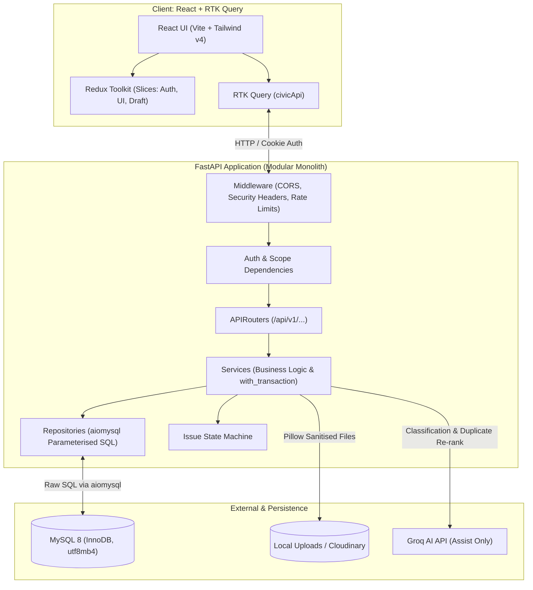
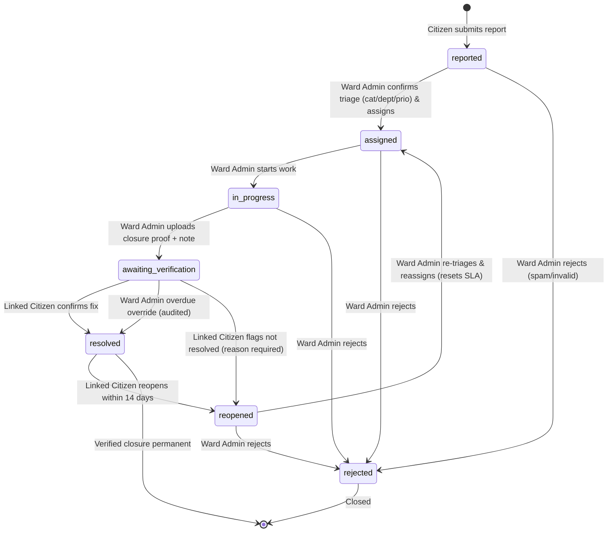

# CivicFix Architecture

## System Overview

CivicFix is architected as a clean modular monolith:

1. **Frontend (`frontend/`)**: React 19 (Vite, JavaScript), Tailwind CSS v4, Redux Toolkit + RTK Query, React Bits, Lucide React, Leaflet, and Chart.js.
2. **Backend API (`backend/`)**: Python 3.12+ with FastAPI and Uvicorn. Layered architecture: `APIRouter` -> Dependencies (Auth, Role check, Rate limit) -> Route handlers -> Service (business transactions) -> Repository (parameterised raw SQL).
3. **Database (`MySQL 8`)**: Relational database with InnoDB, utf8mb4, spatial indexing, CHECK constraints, and strict transactions.
4. **AI Assist (`Groq API`)**: Groq AI SDK (server-side only) with structured outputs, prompt-injection isolation, and deterministic local fallback (`mock.py`).

---

## Issue Lifecycle State Machine

Status transitions are governed strictly by `issue_state_machine.py`. Every transition executes inside an active transaction, locks the issue row (`SELECT ... FOR UPDATE`), verifies actor permissions and prerequisite conditions, writes an immutable `issue_updates` row, and creates in-app notifications.

### Transition Matrix Summary

| From                       | To                      | Actor            | Pre-conditions                                                                                  |
| -------------------------- | ----------------------- | ---------------- | ----------------------------------------------------------------------------------------------- |
| `reported`                 | `assigned`              | `ward_admin`     | Confirmed category, department, priority. Optional assignee matching department.                |
| `assigned`                 | `in_progress`           | `ward_admin`     | Direct start.                                                                                   |
| `assigned` / `in_progress` | `awaiting_verification` | `ward_admin`     | Requires at least 1 'after' evidence photo + closure note.                                      |
| `awaiting_verification`    | `resolved`              | linked `citizen` | Citizen confirmation. Overdue override permitted for ward_admin after 7 days with audited note. |
| `awaiting_verification`    | `reopened`              | linked `citizen` | Citizen dispute with reason. Increments `reopened_count`.                                       |
| `resolved`                 | `reopened`              | linked `citizen` | Allowed strictly within 14 days of `resolved_at`.                                               |
| `reopened`                 | `assigned`              | `ward_admin`     | Re-assigns and recalculates SLA clock.                                                          |
| `*`                        | `rejected`              | `ward_admin`     | Allowed from `reported`, `assigned`, `in_progress`, `reopened` with reason.                     |
